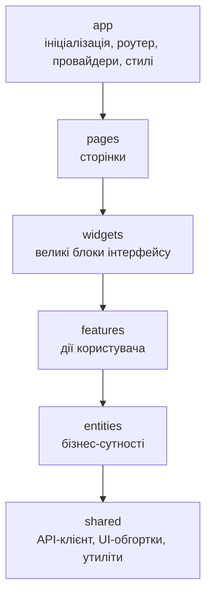
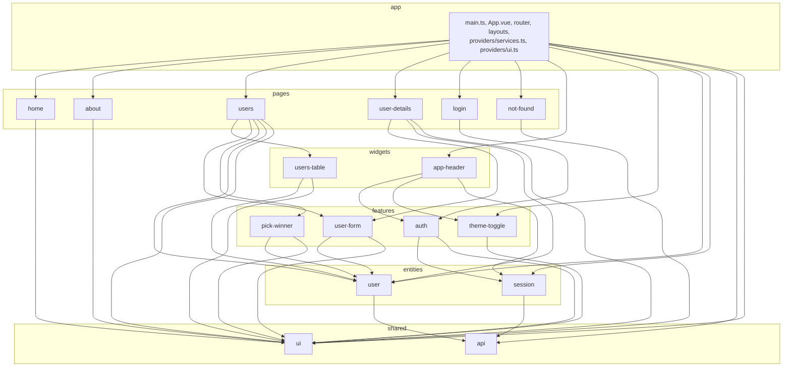

# Vue Lottery App

Застосунок-лотерея на Vue 3: учасники з DummyJSON API, випадковий вибір переможців, авторизація та керування
користувачами.

Лабораторна робота №6: архітектура **Feature-Sliced Design**, керування станом через **Pinia**, UI-бібліотека **PrimeVue
**.

Автор: Дорофтей Катерина Іванівна

## Технології

- Vue 3 (Composition API, `<script setup>`), TypeScript
- Vue Router: ліниве завантаження, guards, вкладені маршрути
- Pinia (setup stores) + `pinia-plugin-persistedstate`
- PrimeVue 4 (тема Aura з власним основним кольором), обгортки в `shared/ui`
- VeeValidate + Yup
- SCSS, Bootstrap (лише базові стилі та утиліти розкладки)
- ESLint, Oxlint, Prettier, **Steiger** (лінтер правил FSD)

## Запуск

```bash
npm install
cp .env.example .env
npm run dev
```

| Скрипт               | Призначення                    |
|----------------------|--------------------------------|
| `npm run dev`        | сервер розробки                |
| `npm run build`      | збірка                         |
| `npm run type-check` | перевірка типів                |
| `npm run lint`       | Oxlint + ESLint + Steiger      |
| `npm run lint:fsd`   | перевірка правил FSD (Steiger) |

## Архітектура: Feature-Sliced Design

### Шари та правило імпортів

Модуль може імпортувати **лише з шарів, розташованих нижче**. Слайси одного шару не імпортують один одного. Імпорт з
іншого слайса виконується лише через його Public API (`index.ts`).



Стрілка означає «може імпортувати». Залежності транзитивні: наприклад, `pages` може імпортувати і з `features`, і з
`shared`. У зворотному напрямку імпорти заборонені, і це перевіряє Steiger.

### Залежності між слайсами проєкту



### Структура `src`

```
src/
├── app/
│   ├── providers/
│   │   ├── router/        # маршрути, guards (beforeEach, afterEach)
│   │   ├── services.ts    # реєстрація UserService і AuthService у ServiceProvider
│   │   └── ui.ts          # підключення PrimeVue, тема, ToastService
│   ├── layouts/           # DefaultLayout, AuthLayout
│   ├── styles/
│   ├── App.vue
│   └── main.ts
├── pages/                 # home, about, users, user-details, login, not-found
├── widgets/
│   ├── app-header/        # AppHeader, AppNavigation, AppLogo
│   └── users-table/       # UsersTable
├── features/
│   ├── auth/              # LoginForm, LogoutButton
│   ├── user-form/         # створення та редагування користувача (VeeValidate)
│   ├── pick-winner/       # вибір переможців, winners store
│   └── theme-toggle/      # перемикач світлої/темної теми, theme store
├── entities/
│   ├── user/              # model (типи, users store), api (UserService)
│   └── session/           # model (session store, типи), api (AuthService)
└── shared/
    ├── api/               # http-client, token-storage, інтерфейси Repository, ServiceProvider
    └── ui/                # AppButton, AppInput, AppTable, AppConfirmDialog, ...
```

## Repository у FSD

| Частина                                                                  | Розташування                |
|--------------------------------------------------------------------------|-----------------------------|
| HTTP-клієнт, інтерфейси `Readable`, `Creatable`, `Editable`, `Deletable` | `shared/api`                |
| `ServiceProvider` (універсальний реєстр сервісів)                        | `shared/api`                |
| `User`, `CreateUserDto`, `UpdateUserDto`                                 | `entities/user/model`       |
| `UserService`                                                            | `entities/user/api`         |
| `AuthService`                                                            | `entities/session/api`      |
| Реєстрація сервісів у `ServiceProvider`                                  | `app/providers/services.ts` |

`ServiceProvider` не імпортує конкретних сервісів, бо `shared` не може залежати від `entities`. Сервіси реєструються в
шарі `app`, а стори отримують їх за ключем: `ServiceProvider.get<UserService>('users')`.

## Керування станом (Pinia)

| Стор              | Шар                     | Призначення                                                                                                |
|-------------------|-------------------------|------------------------------------------------------------------------------------------------------------|
| `useSessionStore` | `entities/session`      | токени, ознака авторизації, поточний користувач, `setSession` / `clearSession`                             |
| `useUsersStore`   | `entities/user`         | список, `total`, `isLoading`, `error`, `fetchUsers`, `fetchUser`, `createUser`, `updateUser`, `removeUser` |
| `useWinnersStore` | `features/pick-winner`  | переможці лотереї (до трьох), підписка на дії `useUsersStore` через `$onAction`                            |
| `useThemeStore`   | `features/theme-toggle` | світла / темна тема, збереження в `localStorage`                                                           |

Сторінки та віджети звертаються до даних лише через стори, а не до сервісів напряму.

### Збереження стану: вручну і через плагін

У `session.store.ts` використано обидва підходи: токени зберігаються вручну через `tokenStorage`, поточний користувач —
плагіном `pinia-plugin-persistedstate` (`persist: { key: 'session', pick: ['user'] }`).

|                   | Ручна реалізація (токени)                                        | Плагін (`user`)                             |
|-------------------|------------------------------------------------------------------|---------------------------------------------|
| Обсяг коду        | функції читання, запису, видалення, `try/catch` для `JSON.parse` | одна опція `persist`                        |
| Синхронізація     | треба викликати збереження в кожній дії                          | автоматично після будь-якої зміни           |
| Відновлення       | вручну в початковому значенні `ref`                              | автоматично при створенні стору             |
| Контроль          | повний: свої ключі й момент запису                               | через налаштування `key`, `pick`, `storage` |
| Доступ поза Pinia | так, `tokenStorage` використовує HTTP-клієнт                     | ні, лише через стор                         |
| Залежності        | немає                                                            | додатковий пакет                            |

Токени залишено на ручному збереженні, бо їх читає та оновлює HTTP-клієнт у шарі `shared`, який не може імпортувати стор
з `entities`.

## UI-бібліотека

- Компоненти PrimeVue імпортуються **лише** в `shared/ui` та `app/providers/ui.ts`. Решта застосунку використовує
  обгортки: `AppButton`, `AppInput`, `AppSelect`, `AppTable`, `AppConfirmDialog`, `AppPaginator`, `AppMessage`,
  `AppSpinner`, `AppChip`, `AppToast`, `useNotify`.
- Tree-shaking: кожен компонент імпортується окремо (`import Button from 'primevue/button'`), тож у збірку потрапляє
  лише використане.
- Тема: Aura з основним кольором `sky` через `definePreset`; темний режим вмикається класом `.app-dark`.